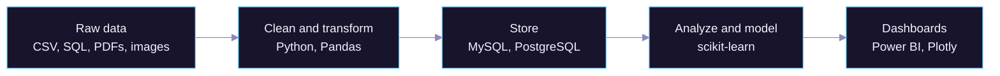

I turn raw data and manual processes into dashboards, pipelines and software that run on their own. I'm building a web and SaaS agency (HRMS, ERP and automation tools) and take on client projects in web apps, dashboards and automation.

[Email](mailto:piyushnirmal.dev@gmail.com)  /  [LinkedIn](https://www.linkedin.com/in/piyush-nirmal)  /  [GitHub](https://github.com/piyush-nirmal)

## How I work

## Selected work

<table>
<tr>
<td width="50%" valign="top">
<b>Employee Wellness Dashboard</b> 
Interactive dashboard that analyzes mental health survey data and shows the patterns. 
Flask, Plotly, Python
</td>
<td width="50%" valign="top">
<b>Sales ETL Pipeline</b> 
Extracts, transforms and visualizes sales data from source to report. 
Python, Pandas, MySQL, Power BI
</td>
</tr>
<tr>
<td width="50%" valign="top">
<b>OCR Pipeline</b> 
Reads text from images and PDFs in 80+ languages using computer vision. 
OpenCV, Tesseract, Python
</td>
<td width="50%" valign="top">
<b>Sports League Analysis System</b> 
Manages league data and compares player and team performance with SQL. 
MySQL, SQL
</td>
</tr>
</table>

## What I build

- **SaaS applications:** HRMS, ERP and other business tools
- **Dashboards and analytics systems:** ETL pipelines through to Power BI reports
- **Automation:** Python workflows that replace repetitive manual work
- **Full-stack web apps:** from database to interface

## Stack

| | |
|:--|:--|
| **Data** |  |
| **Web** |  |
| **Databases** |  |
| **Tools** |  |

<b>Certifications and experience</b>

 

- RDBMS PostgreSQL, Spoken Tutorial Project, IIT Bombay
- Python Training, Google
- Excel with AI (dashboards, macros, VBA), Office Master
- Git Training, IIT Bombay Spoken Tutorial
- Internships in data analytics and development
- Built an end-to-end ETL pipeline on real-world data

## Activity

<picture>
  <source media="(prefers-color-scheme: dark)" srcset="https://raw.githubusercontent.com/piyush-nirmal/piyush-nirmal/output/github-snake-dark.svg">
  <source media="(prefers-color-scheme: light)" srcset="https://raw.githubusercontent.com/piyush-nirmal/piyush-nirmal/output/github-snake.svg">
  
</picture>

I build real-world solutions, not just projects.
